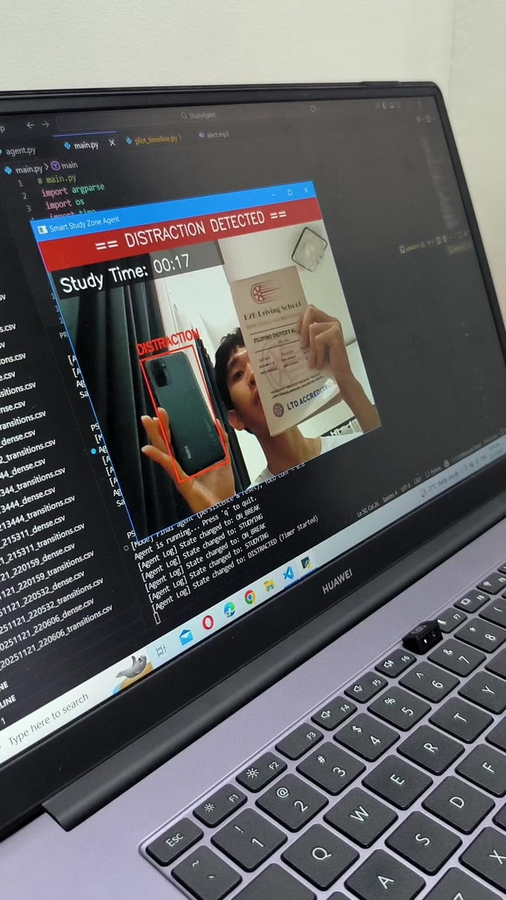
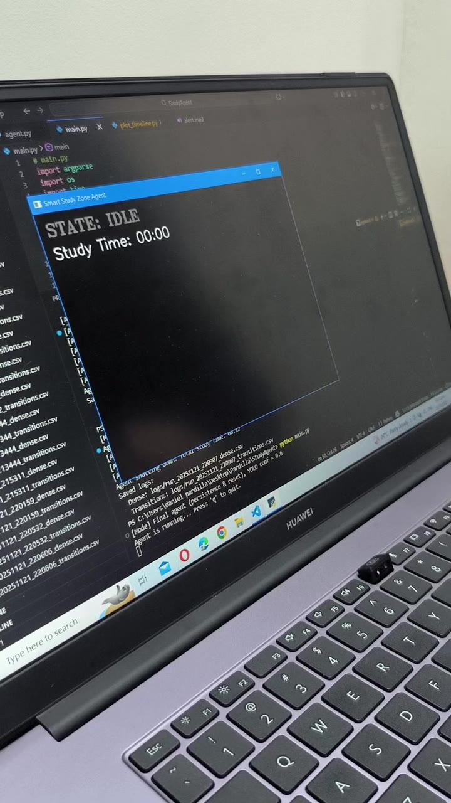
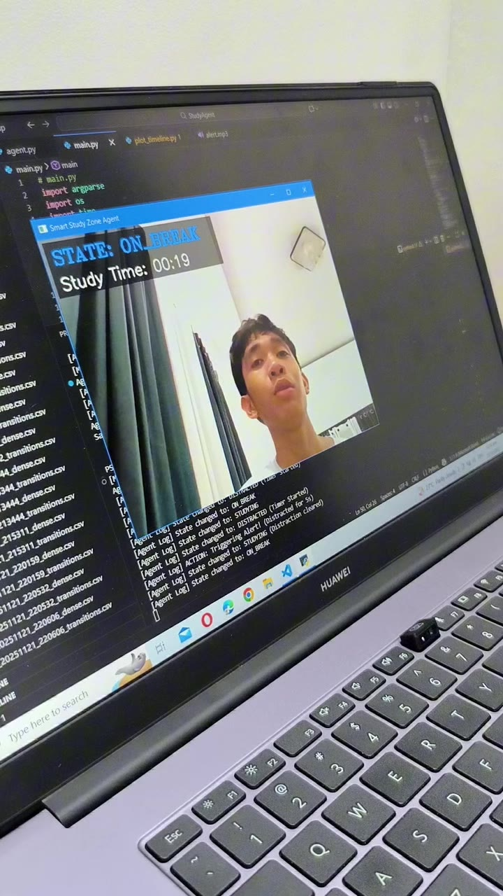

# Smart Study Zone — AI-Powered Study Focus Monitoring Agent

**An individual / solo project** that uses computer vision and a finite-state agent to monitor visible study activity through a webcam and provide alerts when a phone is detected during a study session.

[](docs/demo/Smart-Study-Zone-Live-Demo.mp4)

[▶ Watch the live demo recording](docs/demo/Smart-Study-Zone-Live-Demo.mp4)

> The demo recording is included in this repository as an MP4 file. The screenshots below are selected frames from that recording.

## Project Overview

Smart Study Zone is a Python-based computer-vision prototype designed to encourage focused study sessions. It uses a pre-trained **YOLOv8** object-detection model to identify a person, a book, and a cell phone in the webcam feed. A custom **four-state finite-state machine (FSM)** interprets those detections, updates the study timer, and triggers an alert when a phone remains visible during a detected study session.

The application displays the current state and accumulated study time in a live OpenCV window. It also exports CSV logs that can be used to review the agent's state timeline and compare the baseline and final configurations.

## Demo Preview

### 1. IDLE state

The agent displays `IDLE` when a person has not been detected within its configured persistence window.



### 2. DISTRACTED state — phone detection

When the agent is in `STUDYING` and detects a cell phone, it changes to `DISTRACTED`. The detected phone is outlined and labeled, and the application displays a distraction banner.


### 3. ON_BREAK state

The agent displays `ON_BREAK` when a person is detected but study material is not detected within the persistence window.



## Main Features

- **Webcam-based object detection:** Uses YOLOv8 to detect the `person`, `book`, and `cell phone` classes.
- **Four-state focus model:** Tracks `IDLE`, `STUDYING`, `ON_BREAK`, and `DISTRACTED` states.
- **Distraction detection:** Detects a cell phone while the agent is in the `STUDYING` state.
- **Alerts:** Sends a desktop notification and plays an alert sound after a distraction persists beyond the configured threshold.
- **Study-time tracking:** Accumulates time while the agent is in the `STUDYING` state.
- **State visualization:** Displays the current state and study timer over the live camera feed; phone detections are highlighted.
- **Stability heuristics:** Uses persistence and reset thresholds to reduce rapid state changes caused by temporarily missed detections.
- **CSV activity logs:** Exports a dense, approximately once-per-second state log and a separate state-transition log.
- **Baseline and final modes:** Supports running a baseline configuration and a heuristic-augmented final configuration.
- **Timeline plotting:** Includes a script for plotting and comparing baseline and final state logs.

## How the Agent Works

The detector passes recognized object labels to the `FocusAgent`. The agent uses these detections and timing rules to update its state.

| State | Current interpretation |
|---|---|
| `IDLE` | No person has been detected within the person-persistence window. |
| `STUDYING` | A person and study material (book) are detected. |
| `ON_BREAK` | A person is detected, but study material is not detected within the persistence window. |
| `DISTRACTED` | A cell phone is detected while the current state is `STUDYING`. |

### Detection and timing rules in the current implementation

- The application loads `yolov8m.pt` and filters detections to COCO class IDs for person (`0`), cell phone (`67`), and book (`73`).
- The final mode uses a default YOLO confidence threshold of `0.6`.
- The baseline mode uses a default confidence threshold of `0.2` and disables the persistence/reset heuristics.
- In final mode, a person or book detection remains considered present for up to **10 seconds** after it was last seen.
- A phone must be absent for **2 seconds** before the agent clears the distracted state.
- The distraction alert threshold is set to **5 seconds** in `main.py`.
- Study time is accumulated only while the current FSM state is `STUDYING`.

These are implementation rules, not a clinical or psychological measure of attention. See [Limitations](#limitations) for important context.

## Technology Stack

| Component | Technology |
|---|---|
| Language | Python |
| Object detection | Ultralytics YOLOv8 (`yolov8m.pt`) |
| Computer vision and camera input | OpenCV |
| Agent logic | Custom Python finite-state machine and timing heuristics |
| Desktop notification | Plyer |
| Alert audio | playsound |
| Data export | Python `csv` module |
| Log analysis and visualization | Pandas, Matplotlib |

## Getting Started

### Requirements

- Python 3.10 or later is recommended.
- A working webcam.
- Windows, macOS, or Linux.
- The YOLOv8 weight file `yolov8m.pt` in the project root. This file is included in the project archive.

### 1. Get the project

Download or clone this repository, then open a terminal in the `StudyAgent` project folder (the folder containing `main.py`, `agent.py`, and `requirements.txt`).

```bash
git clone <your-repository-url>
cd StudyAgent
```

If you downloaded the ZIP instead, extract it and open a terminal in the extracted `StudyAgent` folder.

### 2. Create and activate a virtual environment

**Windows PowerShell**

```powershell
python -m venv .venv
.\.venv\Scripts\Activate.ps1
```

If PowerShell blocks activation scripts, allow activation for the current terminal session only, then activate again:

```powershell
Set-ExecutionPolicy -Scope Process -ExecutionPolicy Bypass
.\.venv\Scripts\Activate.ps1
```

**macOS / Linux**

```bash
python3 -m venv .venv
source .venv/bin/activate
```

### 3. Install dependencies

```bash
python -m pip install --upgrade pip
python -m pip install -r requirements.txt
```

### 4. Run Smart Study Zone

```bash
python main.py
```

The application opens the webcam and displays the **Smart Study Zone Agent** window. Press **`q`** while the display window is active to stop the application. The agent then exports its CSV logs to the `logs/` folder.

> **Camera access:** Close other applications that may be using the webcam. If the camera does not open, check the operating system's camera permissions and confirm that the webcam is available as camera index `0`.

## Running Different Modes

The application defaults to the final, heuristic-augmented configuration.

**Final mode (default):**

```bash
python main.py --mode final
```

**Baseline mode:**

```bash
python main.py --mode baseline
```

**Override the YOLO confidence threshold:**

```bash
python main.py --mode final --conf 0.5
```

**Choose a custom CSV log filename prefix:**

```bash
python main.py --mode final --log-basename logs/my_test_run
```

Each run writes two files using the selected prefix:

- `<prefix>_dense.csv` — state recorded approximately once per second.
- `<prefix>_transitions.csv` — entries recorded when the state changes.

Both files contain `time_s`, `state_id`, and `state` columns.

## Plotting the Baseline vs. Final Timeline

The included `plot_timeline.py` script reads:

- `logs/baseline_run_A_dense.csv`
- `logs/final_run_A_dense.csv`

It generates `figure3_fsm_state_timeline.png` in the project root.

Run it after installing the dependencies and ensuring those two input CSV files are present:

```bash
python plot_timeline.py
```

To plot a different experiment, update the `final_csv` and `base_csv` paths near the top of `plot_timeline.py` to match your log filenames.

## Project Structure

```text
StudyAgent/
├── agent.py                  # FocusAgent FSM, timing rules, and CSV logging
├── main.py                   # Webcam loop, YOLO detection, UI, and alerts
├── plot_timeline.py          # Baseline/final state timeline visualization
├── requirements.txt          # Python dependencies
├── alert.mp3                 # Alert sound
├── yolov8m.pt                # Model loaded by main.py
├── yolov8n.pt                # Additional included YOLOv8 weights
├── yolov8s.pt                # Additional included YOLOv8 weights
├── yolov8l.pt                # Additional included YOLOv8 weights
├── logs/                     # Sample and experiment CSV logs
└── docs/
    ├── demo/
    │   └── Smart-Study-Zone-Live-Demo.mp4
    └── screenshots/
        ├── 01-idle-state.jpg
        ├── 02-distraction-detected.jpg
        └── 03-on-break-state.jpg
```

## Limitations and Notes

- **Focus is inferred from visible objects.** The system does not understand a person's thoughts, learning progress, or actual level of concentration. It uses the presence or absence of a person, book, and phone as visual signals.
- **Detection can be imperfect.** Lighting, camera angle, occlusion, object size, and the environment may affect YOLO detections.
- **The state labels are heuristic.** For example, `ON_BREAK` means that a person is visible but a book has not been detected within the configured persistence window; it does not prove that the person is taking a break.
- **Phone alerts are state-dependent.** A phone is treated as a distraction by the current FSM when detected during `STUDYING`.
- **Local webcam processing.** The provided code processes webcam frames locally and exports state logs. It does not implement image or video upload to a remote service.
- **Model attribution.** The project uses pre-trained YOLOv8 weights from Ultralytics; the project logic and state-management workflow are implemented in this project.

## Project Ownership

**Project type:** Individual / Solo Project  
**Development:** Independently developed

This project demonstrates practical work with Python, computer vision, object detection, finite-state agent design, event-driven alerts, data logging, and experiment visualization.

---

*Smart Study Zone — AI-Powered Study Focus Monitoring Agent.*
